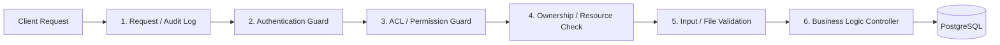

# 📋 รายละเอียดข้อกำหนดโครงงานวิชา Web (Full Specification)

> **วิชา:** พัฒนาเว็บแอปพลิเคชัน สำหรับบริหารจัดการระบบงาน  
> **คะแนนรวม:** 30 คะแนน  
> **กำหนดนำเสนอ:** 27–28 ตุลาคม 2569 (กลุ่มละ 15 นาที: นำเสนอ & สาธิต 12 นาที, ตอบคำถาม 3 นาที)

---

## 🎯 1. วัตถุประสงค์และภาพรวม (Objectives & Scope)
1. พัฒนาเว็บแอปพลิเคชันสำหรับบริหารจัดการระบบงานที่เชื่อมต่อกับฐานข้อมูล **PostgreSQL**
2. ใช้ **Node.js** และ **Express.js** ฝั่ง Server ร่วมกับ **Middleware** ในการ:
   - ตรวจสอบสิทธิ์การเข้าสู่ระบบ (Authentication)
   - ควบคุมการเข้าถึงตามบทบาทและสิทธิ์ (Authorization / Dynamic ACL)
   - บันทึกประวัติการทำงาน (Audit Logging)
   - ตรวจสอบความถูกต้องของข้อมูลและไฟล์ (Data & File Validation)
3. มีระบบ **Authentication** และ **Authorization** ที่จัดการ Role, Permission และ ACL ผ่านหน้าเว็บได้จริง
4. มีกระบวนการทำงานหลัก (Core Workflow) อย่างน้อย 1 กระบวนการที่สมบูรณ์ เช่น:
   $$\text{ส่งคำขอ (Submit)} \longrightarrow \text{พิจารณา (Review)} \longrightarrow \text{อนุมัติ/ปฏิเสธ (Approve/Reject)} \longrightarrow \text{ตรวจสอบสถานะ (Track)}$$

---

## 💻 2. เทคโนโลยีและสถาปัตยกรรม (Tech Stack & Architecture)

### 2.1 Backend & Database
* **Server Framework:** Node.js (Express.js)
* **Database:** PostgreSQL
* **Security:**
  * ป้องกัน SQL Injection ด้วย Parameterized Queries
  * ป้องกัน XSS / CSRF
  * จัดเก็บความลับ (Secrets / DB Credentials) ใน `.env` เท่านั้น (ส่งงานพร้อม `.env.example`)

### 2.2 Middleware Pipeline
การทำงานของ Request แต่ละครั้งต้องผ่าน Middleware ตามลำดับ:

---

## 🔐 3. ข้อกำหนดระบบย่อย (Subsystem Specifications)

### 3.1 Authentication & Password Management
* **วิธีจัดการ Session:** เลือกใช้ **Session** (เช่น `express-session` ร่วมกับ `connect-pg-simple`) หรือ **Token** (เช่น JWT) โดยเตรียมเหตุผลอธิบายในการนำเสนอ
* **การจัดเก็บรหัสผ่าน:** ใช้ **Hash พร้อม Salt** ด้วย `bcrypt` หรือ `Argon2`
  * ❌ ห้ามเก็บรหัสผ่านเป็นข้อความปกติ (Plain Text)
  * ❌ ห้ามใช้วิธีเข้ารหัสแบบ Two-way (ถอดกลับได้)
  * ❌ ห้ามส่ง Password Hash ไปแสดงบนหน้าเว็บ
  * ❌ ห้ามบันทึกรหัสผ่านลง Log
* **การป้องกัน Route:** ผู้ที่ยังไม่ล็อกอินจะไม่สามารถเข้าถึงหน้าบ้านและ API ที่ป้องกันไว้ได้ (HTTP 401 Unauthorized) และเมื่อกด Logout แล้ว ต้องทำให้สถานะเดิมใช้งานไม่ได้ทันที

### 3.2 Dynamic Role, Permission & ACL System
* **บทบาทผู้ใช้ (Roles):** เริ่มต้นต้องมีอย่างน้อย **4 บทบาท** เช่น:
  1. `Admin` (ผู้ดูแลระบบสูงสุด - เข้าถึงได้ทุกฟังก์ชัน)
  2. `Manager / Approver` (ผู้จัดการ / ผู้อนุมัติ)
  3. `Staff / Officer` (เจ้าหน้าที่ผู้ปฏิบัติงาน)
  4. `User / Member` (ผู้ใช้งานทั่วไป)
* **หน้าจอการจัดการผ่านเว็บ (Admin Web Management):**
  * **จัดการ Role:** เพิ่ม, แก้ไข, ลบ Role ผ่านหน้าเว็บได้
  * **จัดการ Permission:** เพิ่ม, แก้ไข, ลบ Permission ผ่านหน้าเว็บได้ (รูปแบบ namespace เช่น `item.read`, `request.create`, `request.approve`)
  * **ตาราง ACL Matrix (Role × Permission):** หน้าตารางที่มี Checkbox กำหนดสิทธิ์ให้แต่ละ Role ได้ทันที
* **กฎเหล็กเรื่อง Dynamic Effect:**
  * การแก้ไข Role หรือ Permission ในตาราง ACL ต้องมีผลในการเข้าถึง API และหน้าเว็บทันที **โดยไม่ต้องแก้ไข Source Code และไม่ต้อง Restart Server**
* **ความปลอดภัยของระบบสิทธิ์:**
  * ป้องกันการลบ Role ที่ยังมีผู้ใช้งานผูกอยู่
  * ป้องกันการเปลี่ยนแปลงที่ทำให้ระบบไม่เหลือบัญชี Admin

### 3.3 การแยกส่วนทางตรรกะ (Logical Separation)
* **URL Paths:**
  * หน้าผู้ใช้ทั่วไป: `/app/...`
  * หน้า Admin: `/admin/...`
  * API ของ Admin: `/api/admin/...`
* ผู้ใช้ที่ไม่มีสิทธิ์ Admin จะต้องเข้าถึงหน้า `/admin/...` หรือเรียก `/api/admin/...` ไม่ได้เป็นอันขาด (HTTP 403 Forbidden) แม้จะพิมพ์ URL ตรงๆ ในเบราว์เซอร์

### 3.4 ระบบอัปโหลดไฟล์ / รูปภาพ (File Upload System)
* มีฟังก์ชันอัปโหลดอย่างน้อย 1 จุดที่ผูกกับข้อมูลในระบบ (เช่น รูปภาพอุปกรณ์, เอกสารแนบคำขอ, ภาพถ่ายแจ้งซ่อม)
* **ตรวจสอบที่ Server:** ตรวจสอบ MIME type และจำกัดขนาดไฟล์สูงสุดฝั่ง Server (ห้ามพึ่งพาแค่นามสกุลไฟล์หรือการเช็คบน Frontend)
* **ความปลอดภัยของไฟล์:**
  * เปลี่ยนชื่อไฟล์เป็นรูปแบบที่ไม่ชนกัน (เช่น `uuid` หรือ `timestamp`)
  * ป้องกัน Path Traversal
* **บันทึก Metadata ใน PostgreSQL:** เก็บชื่อเดิม, Path ที่จัดเก็บ, ประเภทไฟล์ (MIME), ขนาด (Bytes), วันเวลา, ผู้อัปโหลด และ ID ของรายการที่เกี่ยวข้อง
* **การเข้าถึงไฟล์:** หากเป็นไฟล์ที่มีการจำกัดสิทธิ์ ห้ามเปิดเป็น Public Static URL โดยตรง ต้องดาวน์โหลดผ่าน Route ที่มี Middleware ตรวจสอบสิทธิ์

### 3.5 ระบบบันทึกประวัติการทำงาน (Audit Logging)
* จัดเก็บ Log ลงตารางในฐานข้อมูล PostgreSQL (ข้อมูลต้องอยู่ถาวรแม้รีสตาร์ต Server)
* **เหตุการณ์ที่ต้องบันทึก:**
  1. การเข้าสู่ระบบสำเร็จ และ ล้มเหลว
  2. การออกจากระบบ
  3. การเพิ่ม, แก้ไข, ลบ ข้อมูลสำคัญ
  4. การเพิ่ม, แก้ไข, ลบ Role หรือ Permission และการปรับตาราง ACL
  5. การพยายามเข้าถึงทรัพยากรที่ถูกปฏิเสธ (403 Forbidden)
  6. การอัปโหลดและลบไฟล์
* **ฟิลด์ข้อมูลใน Log:** วันเวลา (Timestamp), ผู้กระทำ (User ID/Name/IP), เหตุการณ์ (Action), ทรัพยากรที่เกี่ยวข้อง (Target/Resource), ผลลัพธ์ (Success/Fail/Error Details)
* **หน้าดูประวัติ (Log Viewer UI):** มีหน้าเว็บสำหรับดู Log ย้อนหลัง พร้อมระบบค้นหาและกรอง (Filter) ตามช่วงเวลา, ผู้ใช้, และประเภทเหตุการณ์ (เฉพาะผู้มีสิทธิ์เท่านั้นที่เข้าดูได้)

---

## 📊 4. โครงสร้างฐานข้อมูลและเอกสารที่ต้องจัดทำ
1. **ER Diagram:**
   * แสดง Entity, Attributes, Primary Key (PK), Foreign Key (FK)
   * แสดง Cardinality ความสัมพันธ์ (1:1, 1:N, N:M) อย่างถูกต้อง
   * ครอบคลุม Users, Roles, Permissions, Role_Permissions (ACL), Audit_Logs, Files, และ ตารางระบบงานหลัก
2. **Access Matrix Table:**
   * ตารางสรุป Role × ทรัพยากร/ฟังก์ชัน × การกระทำ (Create, Read, Update, Delete, Approve)
   * ระบุเงื่อนไขพิเศษ (เช่น ดูได้เฉพาะรายการของตนเอง) ให้ตรงกับระบบจริง
