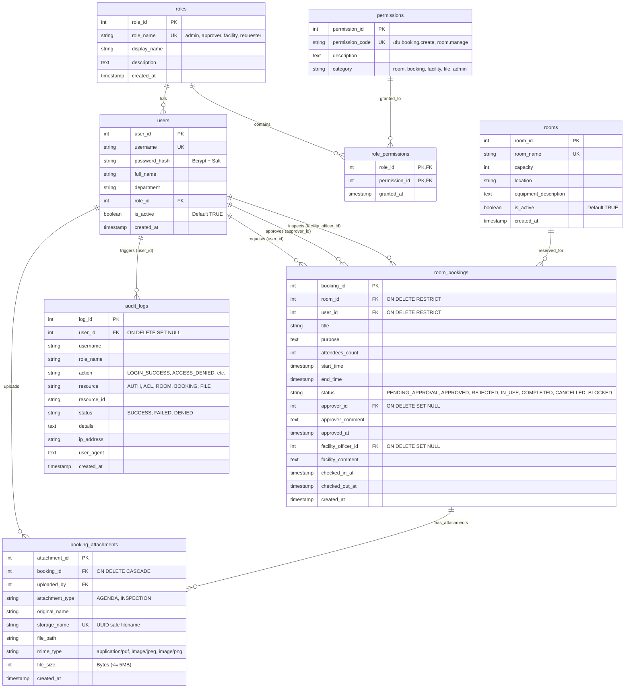

# 📊 แผนผังความสัมพันธ์ฐานข้อมูล (ER Diagram & Schema Specification)

> **วิชา:** พัฒนาเว็บแอปพลิเคชัน สำหรับบริหารจัดการระบบงาน (30 คะแนน)  
> **ระบบ:** RoomReserve (SmartSpace) — ระบบบริหารจัดการจองห้องประชุมและทรัพยากรส่วนกลาง  
> **ฐานข้อมูล:** PostgreSQL (พร้อม btree_gist extension)

---

## 📐 1. Entity Relationship Diagram (ER Diagram)

---

## 🛡️ 2. กฎและเงื่อนไขความถูกต้อง (Integrity Constraints)

| ตาราง | Constraint Name | ประเภท | รายละเอียดและการบังคับใช้ |
| :--- | :--- | :--- | :--- |
| `room_bookings` | `no_overlapping_active_bookings` | **EXCLUDE USING gist** | ป้องกันการจองช่วงเวลาทับซ้อนกันในห้องเดียวกัน (`room_id WITH =`, `tsrange(start_time, end_time) WITH &&`) มีผลกับสถานะ `PENDING_APPROVAL`, `APPROVED`, `IN_USE`, `BLOCKED` |
| `room_bookings` | `check_time_validity` | **CHECK** | ตรวจสอบว่าเวลาสิ้นสุดต้องมากกว่าเวลาเริ่มต้นเสมอ (`end_time > start_time`) |
| `room_bookings` | `check_booking_status` | **CHECK** | จำกัดค่าสถานะให้อยู่ในชุดที่กำหนด: `PENDING_APPROVAL`, `APPROVED`, `REJECTED`, `IN_USE`, `COMPLETED`, `CANCELLED`, `BLOCKED` |
| `role_permissions` | `PRIMARY KEY (role_id, permission_id)` | **COMPOSITE PK** | รับประกันว่า 1 Role จะมี Permission เดียวกันได้เพียง 1 แถว |
| `role_permissions` | `ON DELETE CASCADE` | **FK Rule** | เมื่อลบ Role หรือ Permission ระบบจะล้างความสัมพันธ์ในตารางสิทธิ์ออกอัตโนมัติ |
| `room_bookings` | `ON DELETE RESTRICT` | **FK Rule** | ห้ามลบข้อมูล Room หรือ User ตราบใดที่ยังมีประวัติการจองห้องอ้างอิงอยู่ |
| `audit_logs` | `ON DELETE SET NULL` | **FK Rule** | หาก User ถูกลบ ข้อมูลบันทึกความปลอดภัยยังคงอยู่ถาวร (เปลี่ยน `user_id` เป็น NULL) |

---

## 🎓 3. สาระสำคัญสำหรับตอบคำถามอาจารย์ (Q&A Defense)

### ถาม: ทำไมจึงต้องใช้ Exclusion Constraint (`btree_gist`) ในระดับ Database แทนที่จะเช็คเวลาว่างด้วย JavaScript ใน Server?
> **ตอบ:**  
> หากตรวจสอบด้วย JavaScript เพียงอย่างเดียว (`SELECT` ตรวจเวลาว่างก่อน แล้วค่อย `INSERT`):  
> เมื่อมีผู้ใช้ 2 คนกดจองห้องเดียวกัน เวลาเดียวกัน พร้อมกันในเสี้ยววินาที (Concurrent Requests) คำสั่ง `SELECT` ของทั้งสองคนจะเห็นว่าห้องว่างพร้อมกัน และทั้งคู่จะรันคำสั่ง `INSERT` สำเร็จทั้งคู่ ทำให้เกิด **Double-Booking (Race Condition)** ทันที  
>  
> การใช้ **PostgreSQL Exclusion Constraint (`EXCLUDE USING gist`)** จะใช้ Database Engine Lock ในระดับ Kernel/Index ตรวจสอบช่วงเวลา (`tsrange`) แบบ Atomic หากมีรายการใดส่งเข้ามาทับซ้อนแม้แต่ 1 มิลลิวินาที ฐานข้อมูลจะโยน Error Code `23P01` ออกมาทันที ทำให้ระบบมีความปลอดภัยระดับ **Enterprise Concurrency Guard 100%**
