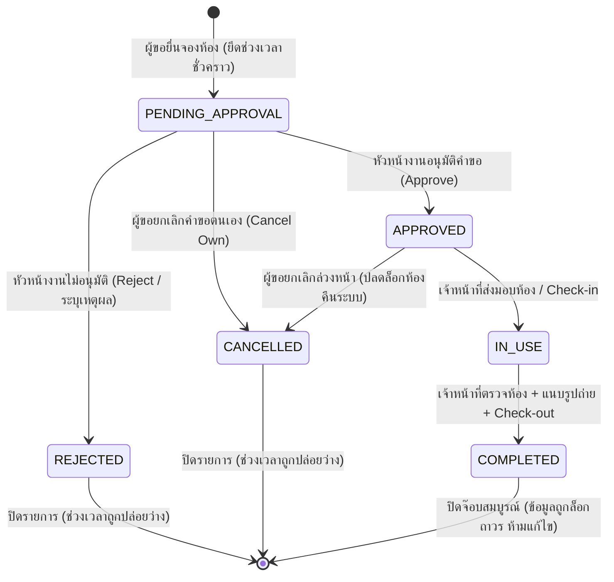

# คู่มือกระบวนการทำงานของระบบ (System Workflow Documentation)
## โครงการ: RoomReserve (SmartSpace) — ระบบบริหารจัดการจองห้องประชุมและทรัพยากรส่วนกลาง
### วิชา: พัฒนาเว็บแอปพลิเคชัน สำหรับบริหารจัดการระบบงาน (30 คะแนน)

เอกสารฉบับนี้อธิบายลำดับขั้นตอนการทำงาน (Workflow) และสถาปัตยกรรมเชิงลึกของระบบ **RoomReserve** ครอบคลุม **Business Logic**, **วงจรสถานะคำขอ (State Lifecycle)**, **การป้องกัน Race Condition & Double-Booking ระดับ Database**, **ระบบจัดเก็บไฟล์พร้อมสิทธิ์ (Anti-IDOR Protected Storage)**, และ **การควบคุมสิทธิ์แบบไดนามิก (Dynamic Role × Permission Matrix)**

---

## สารบัญ
1. [ภาพรวมบทบาทและหน้าที่ (Role & Responsibilities)](#1-ภาพรวมบทบาทและหน้าที่-role--responsibilities)
2. [กระบวนการทำงานหลักแบบ End-to-End (Sequence Flow)](#2-กระบวนการทำงานหลักแบบ-end-to-end-sequence-flow)
3. [วงจรสถานะคำขอจองห้อง (Booking State Machine)](#3-วงจรสถานะคำขอจองห้อง-booking-state-machine)
4. [กลไกขั้นสูง: การป้องกัน Race Condition & Time-Overlap (Concurrency Guard)](#4-กลไกขั้นสูง-การป้องกัน-race-condition--time-overlap-concurrency-guard)
5. [ระบบจัดเก็บไฟล์และความปลอดภัย (Protected File Storage & Anti-IDOR)](#5-ระบบจัดเก็บไฟล์และความปลอดภัย-protected-file-storage--anti-idor)
6. [ตารางสิทธิ์การเข้าถึง (Dynamic Access Control Matrix)](#6-ตารางสิทธิ์การเข้าถึง-dynamic-access-control-matrix)
7. [การบันทึกประวัติความปลอดภัย (Audit Logging Mechanism)](#7-การบันทึกประวัติความปลอดภัย-audit-logging-mechanism)

---

## 1. ภาพรวมบทบาทและหน้าที่ (Role & Responsibilities)

ระบบแบ่งผู้ใช้งานออกเป็น **4 บทบาท** อย่างเคร่งครัดตามหลักการแบ่งแยกหน้าที่ (Separation of Concerns):

| บทบาท (Role) | รหัสบทบาท | ขอบเขตหน้าที่และความรับผิดชอบ |
| :--- | :--- | :--- |
| **1. ผู้ขอใช้ห้อง (Requester)** | `ROLE_REQUESTER` | • ค้นหาและดูสถานะความว่างของห้องประชุมผ่านปฏิทินกลาง<br>• ยื่นคำขอจองห้อง พร้อมแนบวาระการประชุม (Agenda) หรือผังจัดโต๊ะ (Layout)<br>• ติดตาม แก้ไข หรือยกเลิกคำขอของตนเองได้ตราบใดที่ยังไม่ได้รับการอนุมัติ |
| **2. หัวหน้างาน/ผู้อนุมัติ (Approver)** | `ROLE_APPROVER` | • ตรวจสอบ "ความสมเหตุสมผล" ของการใช้ห้อง (จำนวนคน, วัตถุประสงค์, อุปกรณ์)<br>• ตรวจสอบไฟล์วาระการประชุมผ่าน Secure Stream<br>• กดอนุมัติ (`APPROVED`) หรือปฏิเสธ (`REJECTED`) พร้อมระบุเหตุผล |
| **3. เจ้าหน้าที่สถานที่ (Facility Officer)** | `ROLE_FACILITY` | • **จัดการตารางห้อง:** กดบล็อกวัน/เวลาล่วงหน้ากรณีปิดซ่อมบำรุงหรือมีกิจกรรมองค์กรใหญ่ (`BLOCKED`) เพื่อไม่ให้คนอื่นกดจอง<br>• ส่งมอบห้องและเปิดระบบอุปกรณ์ (Check-in $\rightarrow$ `IN_USE`)<br>• ตรวจสอบสภาพห้องหลังเสร็จสิ้น ถ่ายรูปหลักฐานสภาพห้องแนบเข้าระบบ และปิดงาน (`COMPLETED`) |
| **4. ผู้ดูแลระบบ (Admin)** | `ROLE_ADMIN` | • **ควบคุมระบบและการกำกับดูแล (System Governance Only):** ไม่ยุ่งเกี่ยวกับงานธุรการรายวัน<br>• จัดการบัญชีผู้ใช้งาน เพิ่ม/ระงับบัญชี<br>• ปรับตารางสิทธิ์ Dynamic ACL (Role × Permission) Real-time โดยไม่ต้อง Restart Server<br>• ตรวจสอบ Audit Log เฝ้าระวังความปลอดภัย |

---

## 2. กระบวนการทำงานหลักแบบ End-to-End (Sequence Flow)

```mermaid
sequenceDiagram
    autonumber
    actor Req as 👤 Requester (ผู้จอง)
    actor App as 👔 Approver (ผู้อนุมัติ)
    actor Fac as 🛠️ Facility (เจ้าหน้าที่สถานที่)
    actor Adm as 🛡️ Admin (ผู้ดูแลระบบ)
    participant Web as 🌐 Frontend Web (UI)
    participant API as ⚙️ Express Backend Pipeline
    participant DB as 🗄️ PostgreSQL (ACID & Row Locks)
    participant Disk as 📁 Protected Storage

    %% ขั้นตอนการตั้งค่าห้องและบล็อกวันล่วงหน้า
    rect rgb(30, 41, 59)
    Note over Fac, DB: 1. การกันห้องสำหรับงานซ่อมบำรุง/กิจกรรมใหญ่ (Preventive Blocking)
    Fac->>Web: กำหนดช่วงเวลาปิดซ่อม/งานคณะ (เช่น 25 ต.ค. 08:00 - 17:00)
    Web->>API: POST /api/rooms/:id/block (ตรวจสิทธิ์ room.block_schedule)
    API->>DB: Transaction: SELECT ... FOR UPDATE -> INSERT room_blocks -> COMMIT
    DB-->>Web: ปฏิทินขึ้นสถานะ "BLOCKED (สีเทา)" ทันที พนักงานจะไม่สามารถเลือกเวลานี้ได้
    end

    %% ขั้นตอนการจองห้อง
    rect rgb(30, 58, 138)
    Note over Req, Disk: 2. การยื่นคำขอจองห้องและการป้องกัน Race Condition
    Req->>Web: เลือกห้องและเวลาว่าง กรอกหัวข้อประชุม แนบวาระการประชุม (Agenda PDF)
    Web->>API: POST /api/bookings (ตรวจสิทธิ์ booking.create)
    API->>DB: BEGIN Transaction -> SELECT room FOR UPDATE -> Check Overlap -> INSERT bookings -> COMMIT
    Web->>API: POST /api/files/upload (MIME Magic Bytes, Size <= 5MB)
    API->>Disk: สุ่มชื่อ UUID v4 บันทึกลง uploads/agendas/
    API->>DB: บันทึก booking_attachments & audit_logs (SUCCESS)
    end

    %% ขั้นตอนการพิจารณาอนุมัติ
    rect rgb(20, 83, 45)
    Note over App, DB: 3. การตรวจสอบความเหมาะสม (Approval Phase)
    App->>Web: เปิดดูรายการรออนุมัติ (PENDING_APPROVAL)
    App->>Web: คลิกดูไฟล์วาระการประชุม (Secure Stream)
    Web->>API: GET /api/files/:id (ตรวจสิทธิ์ file.view & Ownership/Role)
    API->>Disk: Stream ไฟล์ให้ Approver
    alt กรณีอนุมัติ (Approve)
        App->>Web: กดอนุมัติ (APPROVE)
        Web->>API: POST /api/bookings/:id/action (action: APPROVE)
        API->>DB: UPDATE สถานะเป็น APPROVED -> บันทึก audit_logs
    else กรณีปฏิเสธ (Reject)
        App->>Web: กดปฏิเสธ (REJECT) พร้อมระบุเหตุผล (เช่น ให้ย้ายไปห้องเล็ก)
        Web->>API: POST /api/bookings/:id/action (action: REJECT)
        API->>DB: UPDATE สถานะเป็น REJECTED (ปลดล็อกช่วงเวลา) -> บันทึก audit_logs
    end
    end

    %% ขั้นตอนการดำเนินงานหน้างานจริง
    rect rgb(112, 26, 117)
    Note over Fac, Disk: 4. การส่งมอบและการตรวจสภาพห้อง (Execution & Inspection)
    Fac->>Web: ดูรายการ APPROVED เตรียมจัดห้องตามผัง
    Fac->>Web: กดยืนยัน Check-in ส่งมอบห้อง
    Web->>API: POST /api/bookings/:id/checkin -> สถานะ IN_USE
    Note over Req, Fac: ประชุมเสร็จสิ้น
    Fac->>Web: ตรวจความเรียบร้อย ถ่ายรูปสภาพห้องหลังใช้งาน
    Web->>API: POST /api/files/upload (รูปภาพการตรวจห้อง) -> เก็บลง uploads/inspections/
    Fac->>Web: กดปิดงาน (Check-out)
    Web->>API: POST /api/bookings/:id/checkout -> สถานะ COMPLETED (ล็อกถาวร)
    end
```



---

## 3. วงจรสถานะคำขอจองห้อง (Booking State Machine)

สถานะคำขอถูกควบคุมด้วย Database Constraint (`CHECK status IN (...)`) ดังนี้:



---

## 4. กลไกขั้นสูง: การป้องกัน Race Condition & Time-Overlap (Concurrency Guard)

### ทฤษฎีช่วงเวลาทับซ้อน (Time Overlap Logic)
ช่วงเวลาใหม่ $[S_{new}, E_{new}]$ จะชนกับช่วงเวลาเดิม $[S_{old}, E_{old}]$ ก็ต่อเมื่อ:
$$(S_{new} < E_{old}) \quad \text{AND} \quad (E_{new} > S_{old})$$

### การป้องกันแบบ 2 ชั้น (Double-Layer Defense):

#### ชั้นที่ 1: Pessimistic Row Lock (`SELECT ... FOR UPDATE`) ใน Transaction
```sql
-- 1. เริ่มต้น Transaction
BEGIN;

-- 2. ล็อกแถวของห้องประชุมนั้นทันที ป้องกัน Request อื่นแทรกแซง
SELECT id, room_name 
FROM rooms 
WHERE id = $1 AND is_active = TRUE 
FOR UPDATE;

-- 3. ตรวจสอบการทับซ้อนของช่วงเวลา
SELECT id, title, start_time, end_time 
FROM room_bookings 
WHERE room_id = $1 
  AND status IN ('PENDING_APPROVAL', 'APPROVED', 'IN_USE', 'BLOCKED')
  AND (start_time < $3 AND end_time > $2)
LIMIT 1;

-- 4. หากมีแถวข้อมูลคืนกลับมา แสดงว่ามีคนจองไปแล้ว ให้ ROLLBACK ทันที
-- หากไม่มี ให้ INSERT คำขอใหม่
INSERT INTO room_bookings (room_id, user_id, title, start_time, end_time, status)
VALUES ($1, $user_id, $title, $2, $3, 'PENDING_APPROVAL')
RETURNING id;

-- 5. ยืนยันการเปลี่ยนแปลง
COMMIT;
```

#### ชั้นที่ 2: Hard PostgreSQL Exclusion Constraint
ใช้ Extension `btree_gist` ป้องกันในระดับโครงสร้างฐานข้อมูล แม้จะมีการยิง API ระดับเสี้ยววินาทีพร้อมกัน:
```sql
CREATE EXTENSION IF NOT EXISTS btree_gist;

ALTER TABLE room_bookings 
ADD CONSTRAINT no_overlapping_bookings
EXCLUDE USING gist (
  room_id WITH =,
  tsrange(start_time, end_time) WITH &&
)
WHERE (status IN ('PENDING_APPROVAL', 'APPROVED', 'IN_USE', 'BLOCKED'));
```
* **ผลลัพธ์:** หากมีคำสั่งแทรกซ้อนหลุดเข้ามา PostgreSQL จะดีด Error Code `23P01` (Exclusion Violation) ซึ่งฝั่ง Express จะดักจับแล้วส่งผลลัพธ์ `409 Conflict: ช่วงเวลานี้ถูกจองไปแล้วในเสี้ยววินาทีที่ผ่านมา` กลับไปอย่างแม่นยำ

---

## 5. ระบบจัดเก็บไฟล์และความปลอดภัย (Protected File Storage & Anti-IDOR)

### กฎความปลอดภัยของไฟล์:
1. **No Public Static URL:** ไม่มี Directory Browsing หรือเข้าถึงตรงผ่าน `/uploads/xxx.pdf`
2. **File Validation at Server:**
   - ตรวจสอบ MIME type จาก Magic Bytes
   - รองรับเฉพาะ: `application/pdf`, `image/jpeg`, `image/png`
   - ขนาดไฟล์สูงสุด: $\le$ 5 MB
3. **UUID v4 Renaming:** เปลี่ยนชื่อไฟล์เป็นสุ่มป้องกัน Path Traversal และชื่อชนกัน
4. **Ownership & Access Verification Route (`GET /api/files/:id`):**
   - ผู้ใช้ต้องล็อกอิน (401 Unauthorized)
   - ตรวจสิทธิ์ `file.view` ในตาราง ACL (403 Forbidden)
   - ตรวจสิทธิ์ความเป็นเจ้าของ: ผู้จองดูได้เฉพาะไฟล์ของตนเอง ส่วน Approver, Facility และ Admin ดูได้ตามขอบเขตงาน

---

## 6. ตารางสิทธิ์การเข้าถึง (Dynamic Access Control Matrix)

| สิทธิ์ / ทรัพยากร | Permission Code | Requester | Approver | Facility | Admin | เงื่อนไข / ขอบเขต |
| :--- | :--- | :---: | :---: | :---: | :---: | :--- |
| **ดูตารางปฏิทินห้อง** | `room.view_schedule` | ✅ | ✅ | ✅ | ✅ | เข้าดูเวลาว่างของแต่ละห้อง |
| **จองห้องประชุม** | `booking.create` | ✅ | ❌ | ❌ | ✅ | สร้างคำขอจองห้อง |
| **ดูคำขอของตนเอง** | `booking.read_own` | ✅ | ✅ | ✅ | ✅ | ดูเฉพาะที่ `user_id = me` |
| **ดูคำขอทั้งหมด** | `booking.read_all` | ❌ | ✅ | ✅ | ✅ | ตรวจสอบภาพรวมการใช้งาน |
| **ยกเลิกคำขอตนเอง** | `booking.cancel_own` | ✅ | ❌ | ❌ | ✅ | ยกเลิกได้เฉพาะก่อนเริ่มงาน |
| **อนุมัติ/ไม่อนุมัติ** | `booking.approve` | ❌ | ✅ | ❌ | ✅ | พิจารณาความเหมาะสม |
| **บล็อกตารางห้อง** | `room.block_schedule` | ❌ | ❌ | ✅ | ✅ | **Facility เป็นผู้บล็อกซ่อมบำรุง/งานใหญ่** |
| **ส่งมอบห้อง (Check-in)** | `facility.checkin` | ❌ | ❌ | ✅ | ✅ | เปิดห้องและมอบอุปกรณ์ |
| **ตรวจห้อง (Check-out)** | `facility.checkout` | ❌ | ❌ | ✅ | ✅ | ปิดงานหลังตรวจความเรียบร้อย |
| **แนบเอกสารวาระ/ผัง** | `file.upload_agenda` | ✅ | ❌ | ❌ | ✅ | อัปโหลดตอนยื่นจอง |
| **แนบรูปตรวจสภาพห้อง** | `file.upload_inspect`| ❌ | ❌ | ✅ | ✅ | อัปโหลดตอนตรวจรับห้อง |
| **ดาวน์โหลด/เปิดดูไฟล์** | `file.view` | ✅ | ✅ | ✅ | ✅ | ตรวจสิทธิ์ความเป็นเจ้าของ |
| **จัดการตาราง ACL** | `acl.manage` | ❌ | ❌ | ❌ | ✅ | **Admin คุมระบบ Real-time** |
| **จัดการบัญชีผู้ใช้งาน**| `user.*` | ❌ | ❌ | ❌ | ✅ | เพิ่ม/แก้ไข/ระงับผู้ใช้งาน |
| **ตรวจสอบ Audit Logs** | `log.read` | ❌ | ❌ | ❌ | ✅ | ดูประวัติความปลอดภัยย้อนหลัง |

---

## 7. การบันทึกประวัติความปลอดภัย (Audit Logging Mechanism)

เก็บบันทึกประวัติลงตาราง `audit_logs` ใน PostgreSQL อย่างถาวร:
* **ข้อมูลที่บันทึก:** `id`, `user_id`, `username`, `role`, `action`, `resource`, `resource_id`, `status` (`SUCCESS`/`FAILED`), `ip_address`, `user_agent`, `created_at`
* **เหตุการณ์สำคัญที่บันทึก:**
  - `AUTH`: `LOGIN_SUCCESS`, `LOGIN_FAILED`, `LOGOUT`
  - `BOOKING`: `SUBMIT`, `CANCEL`, `APPROVE`, `REJECT`, `BLOCK_SCHEDULE`
  - `FACILITY`: `CHECKIN`, `CHECKOUT`
  - `FILE`: `UPLOAD_AGENDA`, `UPLOAD_INSPECTION`, `FILE_VIEW`
  - `SECURITY`: `ACCESS_DENIED` (พยายามเข้าหน้า `/admin/...` หรือเข้าถึงไฟล์ที่ไม่มีสิทธิ์)
  - `ACL`: `ROLE_UPDATE`, `PERMISSION_GRANT`, `PERMISSION_REVOKE`
* **Zero Credential Exposure:** ไม่มีการบันทึกรหัสผ่านหรือ Session Cookie ลง Log เด็ดขาด
